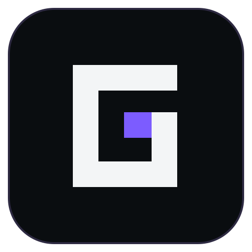
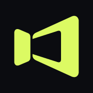

<picture>
  <source media="(prefers-color-scheme: dark)" srcset="assets/banner-dark.svg">
  
</picture>

 

I build products end to end: desktop apps, web services, and the servers and pipelines that keep them running.
Mostly TypeScript, with Go and Python where they fit better.

## Projects

<table>
<tr>
<td width="50%" valign="top">

### [Grubie Launcher](https://grubielauncher.com)

A Minecraft launcher for Windows, macOS and Linux. Installs versions and mod loaders, fetches the right Java, explains crashes, and keeps your friends in the same window: chat, voice, and joining each other's worlds without port forwarding.

Electron · React · TypeScript · Go

</td>
<td width="50%" valign="top">

### [Lumovio](https://lumovio.app)

One account and one history for films, series and anime, wherever you actually watch them. Catalog and watchlists, progress tracking, your own Jellyfin and Plex servers in a built-in player, and a TV mode with QR sign-in.

Next.js · Fastify · PostgreSQL · Redis

</td>
</tr>
</table>

## Stack

<picture>
  <source media="(prefers-color-scheme: dark)" srcset="https://skillicons.dev/icons?i=ts%2Cjs%2Creact%2Cnextjs%2Celectron%2Ctailwind%2Cnodejs%2Cgo%2Cpy%2Ckotlin%2Ccs%2Clua%2Cpostgres%2Credis%2Cmongodb%2Cdocker&perline=8&theme=dark">
  
</picture>
